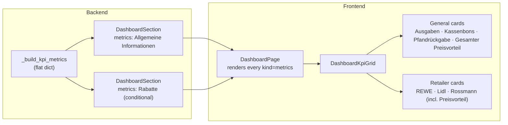

## Context

The dashboard payload is section-based: the backend builds a `DashboardPageModel`
with a list of `DashboardSection` objects, and the Vue frontend renders each
section by `kind`. Today exactly one `metrics` section titled "Kennzahlen" wraps
every KPI card.

The KPI numbers are produced as a flat `dict[str, float]` by
`_build_kpi_metrics` in `api/services/dashboard_builders.py`. Card grouping,
labels, number formatting, and visibility all live in the frontend component
`web/src/components/DashboardKpiGrid.vue`.

In-force ADRs were reviewed (0001–0005 and 0007; 0006 is superseded by 0007).
None of them constrain this dashboard composition change.

## Goals / Non-Goals

**Goals:**

- Present general spending metrics and retailer discounts in two separate
  dashboard sections: "Allgemeine Informationen" and "Rabatte".
- Keep the backend section-based payload contract; section titles stay
  backend-driven.
- Add a Rossmann "Preisvorteil" card consistent with Lidl's "Preisvorteil".
- Keep all non-KPI sections (time series, weekday, top items) unchanged.

**Non-Goals:**

- No change to discount calculation or KPI values.
- No new API endpoint or database migration.
- No redesign of card styling, labels, or formatting beyond the split and the
  new Rossmann card.
- No re-grouping of the existing per-retailer discount cards.

## Decisions

### 1. Split the metrics sections in the backend, not the frontend

The backend emits two `DashboardSection(kind="metrics", ...)` entries:
"Allgemeine Informationen" (always) and "Rabatte" (conditional). Section titles
therefore remain backend-owned and `DashboardPage.vue` stays generic.

*Alternative considered:* render two sub-headings inside the existing single
section in the frontend. Rejected: the outer "Kennzahlen" title and the new
titles would live in the frontend, breaking the section-based backend contract.

### 2. Partition the flat metrics dict by key set

- **General keys:** `spendings`, `spendings_without_discount`, `receipt_count`,
  `avg_receipt_amount`, `saved_deposit`, `total_savings`, `total_savings_pct`.
- **Discount keys:** every remaining `rewe_*`, `lidl*`, `sticker_*`, and
  `rossmann_*` field.

The "Rabatte" section is omitted only when the discount dict is empty (for
example dm-only data). When a discount-capable retailer is selected, the
backend already emits zero-valued discount fields, so the section stays visible
with `0 €` / `0,0 %`.

### 3. Gate card groups by field presence in the frontend

`DashboardKpiGrid.vue` renders a card group only when all of its backing fields
exist in the data it receives. The general group is gated on `spendings`; the
Rewe/Lidl/Rossmann groups are already gated per retailer. This lets the same
component render either section without an extra discriminator prop.

*Alternative considered:* add a `key`/`variant` field to `DashboardSection` and
pass it to the grid. Rejected as unnecessary — field presence already encodes
which section a data dict belongs to.

### 4. Add the Rossmann "Preisvorteil" card

Append `{ title: "Preisvorteil", fields: ["rossmann_discount_amount",
"rossmann_discount_pct"] }` as the last card of the Rossmann group, mirroring
Lidl's "Preisvorteil".

## Architecture

## Risks / Trade-offs

- **Presence-based rendering couples UI to data completeness** → General keys are
  always emitted in the general section; discount fields are emitted per
  retailer, so each section receives exactly the fields it should render.
- **Backend tests selecting `next(kind == "metrics")` may only see the first
  section** → Update tests to collect all metrics sections or select by title.
- **"Preisvorteil" now appears for both Lidl and Rossmann** → Assertions must be
  scoped to the retailer's card group, not global text.
- **Empty vs. zero discount semantics could confuse** → Covered by an explicit
  spec scenario and backend/frontend tests.

## Migration Plan

Single deploy; no database or API version migration. Backend and frontend ship
together. Rollback is a revert of the change commits. Implementation order:
backend split, frontend gating plus Rossmann card, then test updates.

## Open Questions

None. No in-force ADR needs to be revisited for this change.
