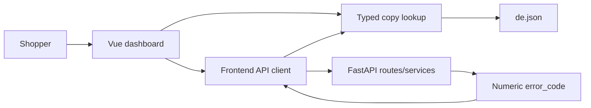

## Context

The Vue dashboard currently mixes German labels with English fallback/error text in components and composables. `web/index.html` declares `lang="en"`. Dashboard and import errors already carry numeric `error_code` values, but the dashboard currently uses a human-readable `detail` field for message selection, and several receipt/import API errors expose a string detail without a stable code. The frontend HTTP helpers may throw on non-success responses before reading an error payload.

The accepted scope is a German-only catalog, not a multi-language product. Existing API/domain values must remain independent of translated labels. HTTP status remains useful for protocol behavior and diagnostics, but the frontend's user-facing error decision is based on `error_code`. Error codes use `4001–4099` for 4xx errors and `5001–5099` for 5xx errors; existing retailer-specific import codes outside those ranges must be migrated without aliases.

## Goals / Non-Goals

**Goals:**

- Put every frontend user-facing string in `web/src/locales/de.json`, including accessibility and document text.
- Use a small typed lookup without adding `vue-i18n` or another dependency.
- Keep labels separate from stable values sent to the backend.
- Ensure frontend-visible API errors carry stable numeric codes and map those codes to German catalog messages.
- Show generic German fallback messages for unknown/missing codes and network failures.

**Non-Goals:**

- No second locale, runtime locale switching, pluralization framework, or locale negotiation.
- No P3 component extraction or unrelated backend error redesign.
- Do not use backend `detail` prose or HTTP status alone to choose user-facing text.
- Do not change successful API payloads or the existing meaning of numeric API values.

## Decisions

- **Use a plain German JSON catalog and a small typed accessor.** Components and composables request catalog keys through a shared helper; the helper handles missing keys with a generic German fallback. This keeps the catalog centralized without adopting a full i18n runtime. A library such as `vue-i18n` is deferred until multiple locales or richer translation behavior are required.
- **Keep machine values separate from display copy.** Filter controls retain stable API values (for example, granularity and ranking identifiers); the UI resolves their German labels from the catalog. Existing formatters continue to handle locale-specific numeric/date output.
- **Treat numeric `error_code` as the frontend-visible error contract.** Assign stable codes from `4001–4099` to 4xx failures and `5001–5099` to 5xx failures, including migrated retailer-specific import failures. Do not retain aliases for the old out-of-range codes. Backend responses retain HTTP status and may retain diagnostic details, but the frontend reads and maps the code before handling a non-2xx response. It does not infer the specific user-facing message/state from status. A missing or unrecognized API code maps to a generic API error; a request with no API response maps to a generic network error.
- **Keep the catalog frontend-owned.** Backend services emit stable codes, not German display strings. This avoids coupling backend behavior to presentation language and permits the frontend to change copy without changing the API contract.

The main boundaries and error/copy flow are:

## Risks / Trade-offs

- [A response path may still expose a raw `detail` or hard-coded frontend string] -> Audit rendered Vue and TypeScript copy, centralize it, and test representative component states and error-code mappings.
- [An HTTP error response may not contain a parseable error payload] -> Map missing/invalid codes to a generic German API error; do not derive a specific message from the status.
- [Codes may collide, leave their assigned range, or be reused accidentally] -> Keep a canonical backend code registry and contract tests that verify all frontend-consumed errors use the correct range and assigned meanings remain stable.
- [A catalog key may be missing or mistyped] -> Type the catalog keys and test the missing-key fallback.

## Migration Plan

No database migration or new dependency. Migrate existing out-of-range import codes to assigned codes with no compatibility aliases. Update frontend consumers to use the code mapping and central catalog; update frontend-consumed backend error responses to include stable codes. Roll back by reverting the frontend catalog/lookup and API error contract changes together.

## Open Questions

None. The chosen diagram is a lightweight Mermaid component/data-flow sketch, consistent with the previously selected format for this project.
