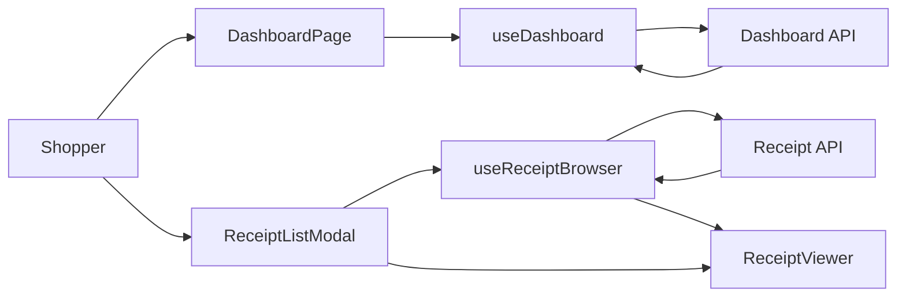

## Context

`useDashboard` observes filter refs through several watchers. A search can also reset the current page, and a retailer change clears search and pagination, so related state changes can trigger an immediate refresh and a scheduled search refresh. Request tokens already prevent older dashboard responses from replacing newer payloads. In the receipt flow, `useReceiptBrowser` catches load failures by clearing the receipt list, so `ReceiptViewer` renders the same message for failure and a successful empty response.

## Goals / Non-Goals

**Goals:**

- Coordinate dashboard refresh scheduling so dependent filter changes share one request.
- Preserve the 400 ms search debounce and latest-request-wins behavior.
- Give the receipt viewer a distinct, resettable error state.

**Non-Goals:**

- No API or backend changes, automatic retry policy, new dependencies, or changes to date-filter semantics.
- No general request-management framework or cancellation abstraction.

## Decisions

- Keep the request coordination local to `useDashboard`. Use one scheduling path for effective filter changes, cancel a pending search timer when an immediate filter transition supersedes it, and retain request identity checks so stale completions cannot mutate payload or loading state. This is preferred to adding a request library or global store for two dashboard-local flows.
- Keep the current 400 ms search debounce. A page reset or retailer change that occurs as part of the same effective transition is included in one resulting request; unrelated filter changes remain immediate.
- Expose a separate receipt-load error state from `useReceiptBrowser` and pass it through `ReceiptListModal` to `ReceiptViewer`. Clear it at the start of a new lookup. Keep the existing successful-empty message, and show a separate generic error message without exposing transport details or adding automatic retry behavior.

The component boundary and state flow are:

## Risks / Trade-offs

- [Watcher interactions can reintroduce duplicate requests] -> Test combined search/page resets, retailer changes during a pending debounce, and rapid successive filter changes with fake timers and request counts.
- [A delayed request may finish after a newer one] -> Keep request identity checks on both success and failure/finalization paths and test out-of-order completion.
- [A generic receipt error gives no diagnostic detail] -> Keep transport details out of the user message; preserve error inspection for tests or future structured reporting without expanding this change.

## Migration Plan

No data or API migration. Roll back by reverting the frontend composable and presentation changes.

## Open Questions

None.
